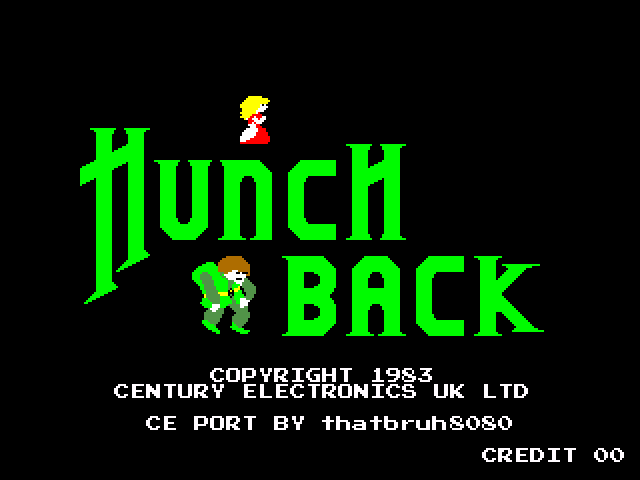
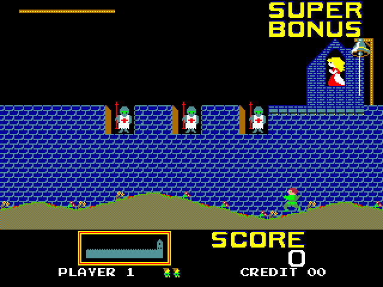
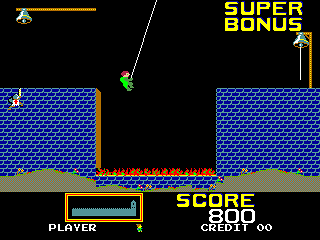

# Hunchback-for-TI-84-Plus-CE
Arcade conversion of the 1983 coin-op game of the same name, made with the CE C Toolchain. So Hunchback in math class wooo

The coin op original was made by Century Electronics, in 1983

  

  

  

Basically you're this not so handsome lad with sciliocis called Quasimodo who has to save the fair princess Esmeralda (I thought she was a French Roma dancer girl) through Nottingham Castle. 
Along the way you have to jump over arrows and fireballs, do some Pitfall-swinging over burning pits, jump over ramparts, some of those ramparts containing knights with lances ready to skewer your butt, four bells you have to jump on and at the end of each screen there's a church bell on the right that you have to ring to get to the next stage. There's 32 stages I believe

You get a **BONUS MAN AT 10000**

# Controls

